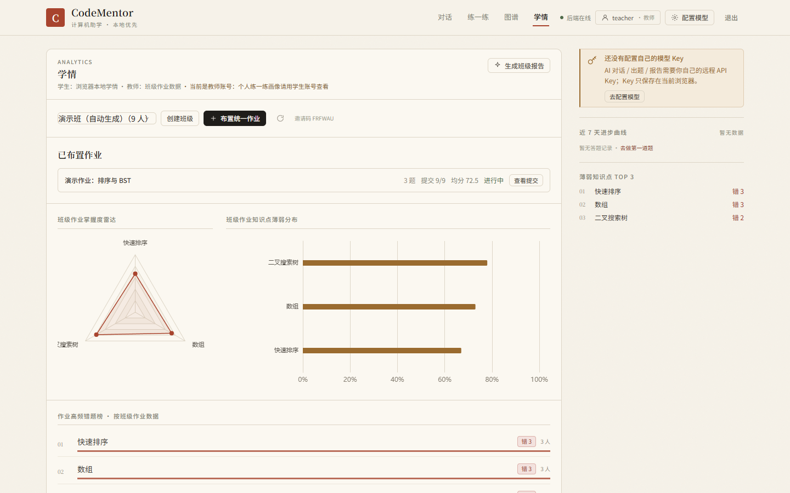
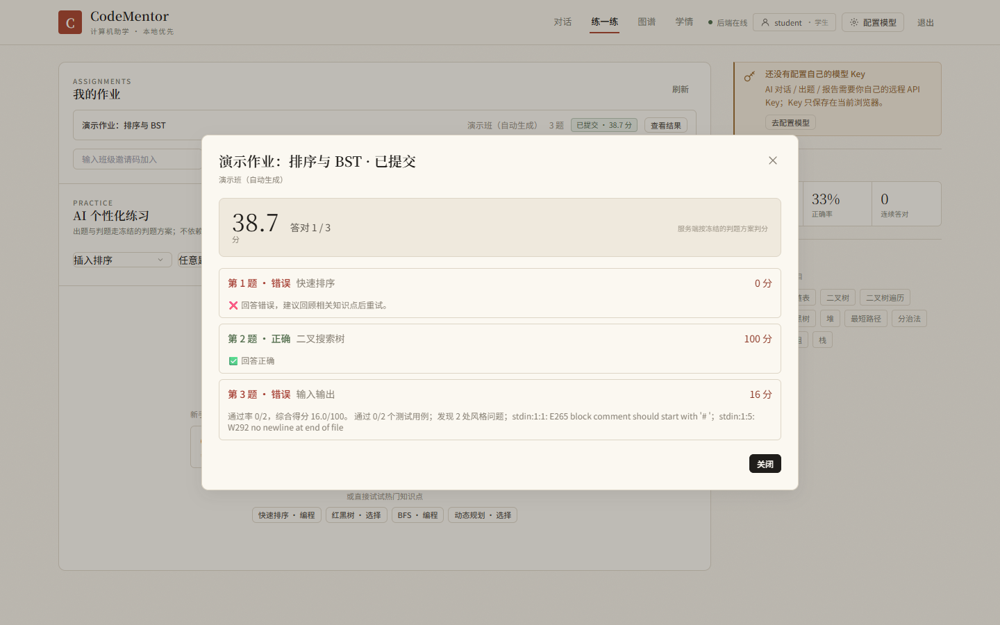
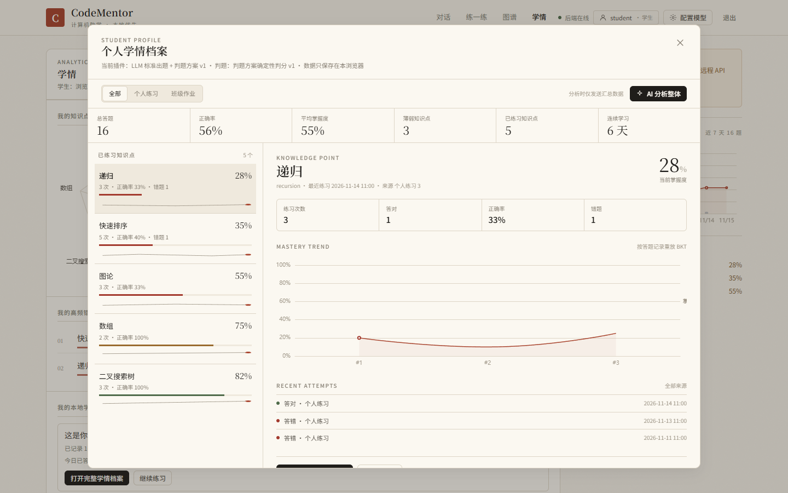

# CodeMentor — Agent + GraphRAG 自适应学习平台（v2）

> 🧠 懂代码、🗺️ 知图谱、⚡ 能动手的 AI 编程导师
>
> 学生用自己的远程 API Key，个人练习数据留在浏览器；教师用班级统一作业看学情。







---

## ✨ 这一版改了什么

相对于旧版，v2 做了四个关键调整：

| 变化 | 说明 |
|---|---|
| 🔐 **学生自带模型 Key** | 学生在右上角「配置模型」填写 DeepSeek / 智谱 Key；Key 只存在浏览器，请求期间由后端转发，服务端不落盘 |
| 🏠 **个人练习本地化** | 日常练习的 BKT、错题本、答题历史、个性化题目全部存在浏览器 localStorage，教师接口读不到 |
| 🏫 **班级统一作业** | 教师可拥有多个班级，通过邀请码加入学生，一次把同一份作业发布给一个或多个班；学生提交一次，服务端判分 |
| 🧾 **判题方案化** | 出题时 LLM 同时生成一份可执行的 `grading_plan`；之后判分不调用 LLM，按方案确定性执行，无服务端 Key 也能批改 |

> 详细插件开发约定见 [PLUGIN_DEV.md](PLUGIN_DEV.md)。

---

## 核心能力

- **Agent 多轮工具调度**：`search_knowledge`（知识问答）/ `analyze_code_ast`（代码分析）/ `execute_code`（沙箱运行）/ `get_learning_path`（学情推荐）/ `generate_practice_questions`（出题练习），最多 3 轮规划 → 调工具 → 再规划，SSE 实时展示思考阶段。
- **GraphRAG**：86 节点 / 93 条有效关系（数据结构、算法、操作系统、计算机网络、数据库）+ ChromaDB 向量检索，向量由 **bge-small-zh-v1.5**（FastEmbed/ONNX，512 维真实语义 Embedding）生成；图谱提供结构关系，向量提供教材片段。
- **我的书架 / 知识源插件**：用户可上传 **PDF / Word(.docx) / TXT / Markdown / EPUB**，后台自动解析、结构感知切片、本地向量化；与内置课程**组合检索**，也可取消内置课程实现**只用书架**。书籍按用户隔离，检索结果带书名/章节/页码出处。
- **Reranker 重排序**：向量粗召回 Top-K 后二次重排——规则重排（图谱关联加权 + 余弦相似度）；若请求携带智谱 Key，自动升级为 **embedding-3（2048 维）** 语义重排。
- **Agent 错误自恢复**：工具调用失败自动重试一次；仍失败则降级为 LLM 直接推理作答，并在回答前明确提示「工具暂时不可用」，不会直接抛错给用户。
- **代码分析**：Python AST 检测嵌套循环、递归、死循环、复杂度启发式；pycodestyle 风格检查。
- **安全执行**：subprocess 沙箱 + 危险模块黑名单 + 超时；可选 Docker 模式（当前镜像未内置 docker CLI，默认 subprocess）。
- **个人学情**：本地 BKT 掌握度、错题本、今日统计、近 7 天曲线、图谱 hover 联动；可打开「个人学情档案」逐知识点查看掌握度 / 趋势 / 来源 / 错题，并调用自己的 LLM 生成整体或单知识点分析；对话与最近一份 AI 分析也会在本地保存，刷新后可恢复；支持导出 / 导入 / 清空。
- **统一作业**：教师多班级、邀请码、作业快照、学生一次提交、服务端确定性判分、教师看板。
- **判题方案**：选择题答案键、编程题测试用例、AST 规则、关键词规则、PEP8 规则等；按规则权重聚合。
- **多模态**：智谱 GLM-4V-Flash 截图答疑（需选择智谱 Key）。
- **零构建前端**：ES Modules + 本地 vendor 依赖，断网可加载；语音提问、响应式布局、图谱缩放/筛选。

---

## 系统架构

```
┌─ 浏览器（学生）──────────────────────────────────────┐
│  模型 Key（session/localStorage，仅本地）              │
│  BKT / 错题本 / 历史 / 个性化练习（localStorage）       │
│  对话消息 / 最近一份 AI 分析缓存（localStorage）        │
│  作业列表 / 作答 / 本地学情合并                        │
└──────────────┬──────────────────────────────────────┘
               │ 请求头 X-LLM-*（仅单次请求使用）
┌──────────────▼──────────────────────────────────────┐
│  FastAPI 后端                                        │
│  ├─ LLM 网关（请求级配置，不保存 Key）                 │
│  ├─ Agent（工具调度 + 本地学情摘要，不持久化）          │
│  ├─ 出题：LLM 生成题目 + grading_plan                 │
│  ├─ 判题：PlanBasedGrader（不调用 LLM）                │
│  ├─ GraphRAG：NetworkX + Chroma + Reranker（512 维）    │
│  ├─ AST / pycodestyle / subprocess 沙箱               │
│  └─ 班级域：classroom.json                             │
└──────────────┬──────────────────────────────────────┘
               │
┌──────────────▼──────────────────────────────────────┐
│  data/：users.json · classroom.json · 知识图谱 · Chroma │
└──────────────────────────────────────────────────────┘
```

### 数据边界

| 数据 | 存放位置 | 教师可见 |
|---|---|---|
| 日常练习 BKT / 错题本 / 历史 / 个性化题目 | 学生浏览器 localStorage（按用户名分区） | ❌ |
| 对话消息 / 最近一份 AI 学情分析 | 学生浏览器 localStorage（按用户名分区，可清空） | ❌ |
| 班级、统一作业、学生提交、作业分数 | 服务端 `backend/data/classroom.json` | ✅（仅自己班级） |
| 用户账号 / 密码哈希 | 服务端 `backend/data/users.json` | — |
| 模型 API Key | 浏览器 session/localStorage | ❌（服务端不持久化） |
| 知识图谱 / 向量库 | 服务端 data/ | — |

> 教师看板只使用**作业数据**，不会读取学生日常练习。个人练习结果可以在学生端合并到本地 BKT，但不会上传。

> 个性化对话/出题时，浏览器会把一份简要学情摘要（薄弱点、错题数）随单次请求发送给后端和 LLM，仅用于当前生成，不持久化，教师接口不接收。

---

## 快速开始

### 环境

- **Python 3.11 / 3.12 / 3.13**（已在 3.13 验证；`chromadb` 需 >=1.5 才有 cp313 轮子，requirements 已适配）
- 无需 Node.js（前端零构建；vendor 已本地化）
- Docker 可选
- 磁盘预留 **约 550 MB**：完整后端 venv 约 464 MB（含 fastembed/onnxruntime/chromadb），bge-small 模型约 91 MB（无需 torch）
- 网络：首次启动需下载 bge-small 模型；默认走 `HF_ENDPOINT=https://hf-mirror.com` 镜像

### 源码运行

```bash
cd backend
python -m venv .venv
# Windows
.venv\Scripts\activate
# macOS/Linux
# source .venv/bin/activate

pip install -r requirements.txt
copy .env.example .env          # Windows
# cp .env.example .env          # macOS/Linux

# 可选：预下载 bge 模型（约 91 MB），便于断网演示
python scripts/warm_embedding.py

# 可选：生成教师班级 + 作业 + 8 份演示提交（不需要 API Key）
python scripts/seed_demo.py

python -m uvicorn app.main:app --host 0.0.0.0 --port 8080
```

打开：

- 前端：`http://localhost:8080/static/index.html`
- API 文档：`http://localhost:8080/docs`
- 健康检查：`http://localhost:8080/health`

**首次使用**：

1. 点击右上角 **⚙️ 配置模型**；
2. 选择 DeepSeek 或智谱 GLM，填入自己的远程 API Key；
3. 点「测试连接」→「保存配置」；
4. 登录 `teacher/123456` 或 `student/123456`。

> 不配置 Key 也可以：登录、加入班级、做老师布置的作业、查看作业结果。

> AI 对话、AI 出题、班级作业生成、LLM 报告、截图答疑需要 Key。

### 测试

```bash
cd backend
python -m pytest tests -v
```

当前测试集 **65 项**。`pytest.ini` 已配置 `pythonpath = .`，不要再用裸 `pytest tests`（旧 README 的写法在部分环境会导致 `ModuleNotFoundError: app`）。

### Docker（可选）

```bash
# 先创建 backend/.env
docker compose -f docker/docker-compose.yml up -d --build
```

- 前端静态目录已修复为同时兼容本地与镜像布局。
- 默认 `SANDBOX_MODE=subprocess`；镜像未安装 docker CLI，因此不是强隔离。
- 比赛/演示环境也可以直接用源码运行。

---

## 演示账号与演示数据

| 角色 | 账号 | 密码 | 说明 |
|---|---|---|---|
| 教师 | `teacher` | `123456` | 创建班级、布置作业、查看看板/报告 |
| 学生 | `student` | `123456` | 加入班级、做作业、个人练习 |

`python scripts/seed_demo.py` 会生成：

- 班级「演示班（自动生成）」及 `student` + `demo_01..demo_08` 成员；
- 一份 3 题统一作业（选择 / 判断 / 编程）；
- 8 名演示学生的提交（不同正确率），`student` 保留未提交，便于现场演示作答。

---

## 功能地图

### 💬 对话

- 理论问答：GraphRAG 检索 → Agent 组织讲解
- 代码调试：沙箱运行 + AST 分析 + 苏格拉底式引导
- **出题练习**：Agent 调 `generate_practice_questions` 工具，按知识点/难度/题型生成选择/判断/编程题，引导学生逐题作答
- 学习路径：读取请求中携带的**本地学情摘要**（不落服务端），结合图谱前置关系
- 截图答疑：需智谱 GLM
- 语音提问：Chrome / Edge Web Speech API
- 思考步骤条：SSE `status` 旁路事件，不进入正文

### 📚 知识库 · 我的书架

- 顶部「知识库」→ 上传 PDF / Word(.docx) / TXT / Markdown / EPUB（单文件默认 ≤ 50MB）
- 上传后后台执行：解析 → 章节/页码感知切片 → bge 向量化 → 入库；列表实时显示进度
- 勾选书籍即可与内置课程一起检索；取消「内置课程库」即切换为**纯书架模式**（知识源替换）
- 书籍仅上传者可见；回答可标注《书名》章节/页码；删除书籍会同步清理向量
- 扫描版 PDF 不做 OCR，需先转文字版；旧版 `.doc` 请另存为 `.docx`
- 知识源通过 `KnowledgeSource` 协议插件化，新增来源无需改 Agent/对话链路，详见 [PLUGIN_DEV.md](PLUGIN_DEV.md)

### 📝 练一练

- **我的作业**（学生）：老师统一作业列表、作答、一次提交、结果回显
- **个人练习**（本地）：按知识点 / 题型 / 难度出题；LLM 出题时生成判题方案
- 判题：选择/判断比对答案；编程题测试用例 + AST/风格规则
- 错题重做、PEP8 检查、Ctrl+Enter 提交、Tab 缩进
- 个人结果只更新浏览器本地 BKT/错题本，可导出/导入

### 🗺️ 图谱

- 86 节点 / 93 边，SVG 力导向
- 缩放、拖拽、分类筛选、搜索定位
- hover 展示本地掌握度、错题次数与前置关系

### 📊 学情

- **学生**：本地雷达图、本地热力分布、本地错题榜、7 天曲线、今日统计；「个人学情档案」支持按全部 / 个人练习 / 班级作业筛选，逐知识点查看掌握度、BKT 轨迹、最近作答与错题，并可调用自己的 LLM 生成整体或单知识点分析
- **教师**：多班级切换、班级作业掌握度雷达、作业薄弱知识点、高频作业错题、学生完成情况、作业提交详情、班级 LLM 报告

---

## API 速查

所有 API 前缀 `/api`。LLM 相关接口需要请求头：

```text
X-LLM-Provider: deepseek | zhipu
X-LLM-Key: <用户自己的远程 Key>
X-LLM-Model: <可选，覆盖预设模型>
```

服务端不保存这些头，也不写日志。

### 认证

| 方法 | 路径 | 说明 |
|---|---|---|
| POST | `/api/auth/register` | 注册（仅学生；教师账号由种子/管理员创建） |
| POST | `/api/auth/login` | 登录 |
| GET | `/api/auth/me` | 当前用户 🔐 |

### 模型设置

| 方法 | 路径 | 说明 |
|---|---|---|
| GET | `/api/settings/llm/providers` | provider 预设（不包含 Key） |
| POST | `/api/settings/llm/test` | 使用请求头 Key 做一次极小的连通性测试 |

### Agent / 出题 / 判题

| 方法 | 路径 | 说明 |
|---|---|---|
| POST | `/api/chat/stream` | Agent SSE 对话（Key） |
| POST | `/api/chat/quick` | 快速问答（Key） |
| POST | `/api/exam/generate` | 出题 + 判题方案（Key） |
| POST | `/api/exam/paper` | 批量出题（Key） |
| POST | `/api/exam/grade` | 按题目快照中的方案判分；**不需要 Key** |
| POST | `/api/analysis/personal` | 个人学情 LLM 分析（Key；只接收聚合后的掌握度 / 趋势 / 错题计数，不落盘） |
| GET | `/api/plugins` | 当前出题 / 判题插件元数据（不含用户数据） |

### 知识库 · 我的书架

`/api/chat/stream` 与 `/api/chat/quick` 额外接收 `knowledge_sources`（`builtin` / `books`）与 `book_ids`，用于本次请求的知识范围。

| 方法 | 路径 | 说明 |
|---|---|---|
| GET | `/api/books` | 书架列表 + 支持格式 + 可用知识源 🔐 |
| POST | `/api/books` | 上传电子书（multipart，后台解析/向量化）🔐 |
| GET | `/api/books/{id}` | 单本书处理状态 / 进度 🔐 |
| DELETE | `/api/books/{id}` | 删除书籍、原始文件与向量 🔐 |
| POST | `/api/books/{id}/reindex` | 重建某本书的向量索引 🔐 |
| GET | `/api/books/sources` | 知识源插件元数据 🔐 |

### 班级 / 作业

| 方法 | 路径 | 说明 |
|---|---|---|
| POST | `/api/classes` | 教师创建班级 🔐 |
| GET | `/api/classes` | 教师看自己的班 / 学生看加入的班 🔐 |
| POST | `/api/classes/join` | 学生用邀请码加入 🔐 |
| GET | `/api/classes/{class_id}` | 班级详情 🔐 |
| POST | `/api/teacher/assignments` | 教师生成并发布统一作业（Key + teacher） |
| GET | `/api/teacher/assignments` | 教师作业列表 🔐 |
| GET | `/api/teacher/assignments/{id}` | 作业详情 + 提交明细 🔐 |
| POST | `/api/teacher/assignments/{id}/close` | 关闭作业 🔐 |
| GET | `/api/teacher/classes/{class_id}/dashboard` | 班级作业看板 🔐 |
| POST | `/api/teacher/assignments/{id}/submissions/{student_id}/override` | 教师改分 🔐 |
| GET | `/api/teacher/classes/{class_id}/report` | 基于作业数据的 LLM 报告（Key + teacher） |
| GET | `/api/assignments/mine` | 学生的作业列表 🔐 |
| GET | `/api/assignments/{id}` | 学生可见题目（不含答案/解析/判题方案）🔐 |
| POST | `/api/assignments/{id}/submit` | 学生提交一次，服务端判分 🔐 |
| POST | `/api/assignments/{id}/retry` | 已提交学生错题重做：按服务端完整快照判分，不返回答案 🔐 |

### 代码 / 图谱 / 系统

| 方法 | 路径 | 说明 |
|---|---|---|
| POST | `/api/code/analyze` | AST 分析 |
| POST | `/api/code/style` | PEP8 检查 |
| POST | `/api/code/execute` | 沙箱执行 |
| POST | `/api/code/test` | 沙箱 + 测试用例 |
| GET | `/api/knowledge/graph` | 完整图谱 |
| GET | `/api/knowledge/search?query=` | 节点搜索 |
| GET | `/api/knowledge/node/{id}` | 节点详情 |
| GET | `/health` | 健康检查 |
| GET | `/api/metrics` | 运行指标（teacher）🔐 |

> 旧版 `/api/bkt/*`、`/api/wrongbook/*`、`/api/teacher/dashboard`、`/api/teacher/students`、`/api/teacher/report` 已移除，避免教师读取学生日常练习。

---

## 判题方案如何工作

1. 出题时，Prompt 要求 LLM 除题目外返回一个 `grading_plan`；
2. 服务端校验/兜底为确定性方案，并随题目快照冻结；
3. 学生提交后，`PlanBasedGrader` 按规则执行：
   - `answer`：选择/判断答案匹配
   - `tests_pass`：沙箱测试用例通过率
   - `no_infinite_loop`：AST 死循环检测
   - `max_loop_depth` / `has_recursion`：结构约束
   - `required_keywords` / `forbidden_keywords`：关键词
   - `pep8`：风格检查
   - `manual`：标记教师复核
4. 加权汇总得分，按 `pass_threshold` 判断是否通过；
5. 判题过程不调用 LLM，不需要任何服务端 Key。

插件接口与扩展方式见 [PLUGIN_DEV.md](PLUGIN_DEV.md)。

---

## 配置说明

`backend/.env` 只保存服务端运行配置（沙箱、数据目录、限流、签名密钥）。
**模型 Key 不再写入 `.env`。**

| 变量 | 默认值 | 说明 |
|---|---|---|
| `AUTH_SECRET` | 开发默认值 | 生产必须设置 |
| `RATE_LIMIT_PER_MIN` | `60` | 每 IP 每分钟请求上限 |
| `SANDBOX_MODE` | `subprocess` | `auto` / `docker` / `subprocess` |
| `SANDBOX_TIMEOUT` | `5` | 沙箱超时 |
| `DATA_DIR` | `./data` | 数据目录 |
| `CHROMA_DIR` | `./data/chroma` | 向量库 |
| `GRAPH_FILE` | `./data/knowledge_graph.json` | 图谱文件 |
| `HF_ENDPOINT` | `https://hf-mirror.com` | 模型下载源；可改为 `https://huggingface.co` |
| `EMBEDDING_CACHE_DIR` | `./data/models` | FastEmbed 模型缓存目录（首次约 91 MB） |
| `BOOKS_DIR` | `./data/books` | 我的书架原始文件、切片与索引 |
| `BOOK_MAX_MB` | `50` | 单本电子书大小上限 |
| `BOOK_CHUNK_SIZE` / `BOOK_CHUNK_OVERLAP` | `500` / `80` | 切片目标字数 / 重叠字数 |
| `BOOK_EMBED_BATCH` | `32` | 向量化与入库批大小 |
| `HOST` / `PORT` | `0.0.0.0` / `8080` | 监听地址 |

### Embedding

采用三级回退，保证「有 Key 更好、无 Key 也能跑」：

| 层级 | 模型 | 维度 | 触发条件 | 用途 |
|---|---|---|---|---|
| 1 | 智谱 `embedding-3` | 2048 | 请求携带智谱 Key | Reranker 阶段精细语义重排 |
| 2 | `BAAI/bge-small-zh-v1.5`（FastEmbed / ONNX 本地） | 512 | 默认 | 向量库建库 + 粗召回 |
| 3 | 本地字符 bigram 哈希 | 512 | bge-small 加载失败 | 极端兜底，保证可用 |

- ChromaDB 统一存 **bge-small 512 维**向量，维度稳定，不会因用户 provider 不同而漂移。
- 本地推理使用 **FastEmbed + ONNX Runtime**，无需 torch；常驻内存约 293 MB，模型加载约 0.1 秒（缓存命中后）。
- **小写归一化**：bge 中文词表不含大写字母（`DFS` / `HTTP` / `Python` 会变成 `[UNK]`），服务会对文档和查询统一小写。实测纯同义改写查询 Top-1 从 80.6% 提升到 93.5%，与 sentence-transformers 官方实现逐条一致。
- 首次启动会自动下载 bge 模型（约 91 MB），默认走 `HF_ENDPOINT=https://hf-mirror.com`；断网演示前可先执行 `python scripts/warm_embedding.py` 预热。
- 向量库会写入模型/维度/索引版本元数据；更换模型或归一化策略后自动清空重建，无需手动删除 `data/chroma/`。

### 知识源路由

- 内置课程与用户书架都实现 `KnowledgeSource` 协议，由 `KnowledgeRouter` 并行检索、去重、按余弦分融合。
- 内置源（`builtin`）继续提供知识图谱节点/前后置关系；书架源（`books`）只提供用户书籍片段。
- 请求只传 `books` 时即进入**替换模式**，不查内置课程；传 `builtin + books` 为混合模式。
- 新增知识源（Obsidian/Notion/网页语料等）：实现协议并在 `app/knowledge/registry.py` 注册，无需改 Agent 与前端。
- 用户书籍按 `user_books_<sha1(username)>` 分 collection 存储，`book_id` 元数据过滤；接口层校验 owner。

---

## 数据文件

| 文件 | 说明 |
|---|---|
| `backend/data/users.json` | 用户（PBKDF2 哈希）；首次启动创建演示账号 |
| `backend/data/classroom.json` | 班级 / 作业 / 提交；原子写 + `.bak`，单进程 RLock |
| `backend/data/knowledge_graph.json` | 86 节点 / 93 边种子（数据结构 / 算法 / 操作系统 / 网络 / 数据库） |
| `backend/data/chroma/` | 内置向量库（bge-small-zh-v1.5，512 维，14 条教材片段）+ 用户书架向量 |
| `backend/data/books/` | 用户上传的原始电子书、切片 JSON 与书架索引 `index.json`（按用户目录隔离） |

浏览器本地：

- `cm_profile_v1:<用户名>`：BKT / 错题本 / 历史 / 已合并作业 id；
- `cm_chat_v1:<用户名>`：最近 120 条、约 20 万字符的对话消息；只保存最终 user / assistant 文本，不保存流式 token、工具过程或思考状态；
- `cm_analysis_v1:<用户名>`：只保存**最新一份** AI 学情分析，每次生成覆盖写入；记录数据指纹，用于提示“数据已更新，建议重新生成”；
- `cm_llm_config_session` / `cm_llm_config_local`：模型 Key（默认 sessionStorage，勾选记住才 localStorage）。

对话可在输入栏点「清空对话」，分析可在档案分析区点「清除缓存」；「清空本地学情」也会同时清除分析缓存。对话/分析属于本地数据，换设备或清理浏览器数据会丢失。

> 单机 JSON 存储适用于比赛/小规模演示；多 worker 部署需要改用数据库或文件锁。当前请保持单 Uvicorn worker。

---

## 代码规范

| 项 | 约定 |
|---|---|
| 后端风格 | PEP 8，行宽上限 120，配置见 [`backend/setup.cfg`](backend/setup.cfg) |
| 后端检查 | `cd backend && python -m pycodestyle app tests` —— 当前 **0 告警** |
| 类型与注释 | Python 关键函数带类型标注 + 中文 docstring；前端 ES Modules + JSDoc |
| 分层结构 | `app/{agents,core,routers,services,plugins}`，路由 / 服务 / 插件职责分离 |
| 提交信息 | 采用 `feat:` / `fix:` / `docs:` / `refactor:` 前缀，附带中文说明 |
| 敏感信息 | `.env` 已加入 `.gitignore`，仓库只保留 `.env.example` 模板 |

---

## 测试

```bash
cd backend
python -m pytest tests -v
```

覆盖：

- API / 权限 / 教师注册限制 / 个人路由移除
- Agent 对话组装 / 最终回答路径 / 历史窗口
- 班级作业 / 作业重做 / 作业看板
- 判题方案 / 题目变体 / 个人学情分析 Prompt
- AST 分析
- BKT 边界与错题本单次扣分
- 沙箱执行 / 危险模块 / 超时
- Token / PBKDF2
- 限流
- 判题方案确定性判分（选择、编程、死循环、默认方案、公开题隐藏答案）
- 班级作业完整流程（建班 → 加入 → 发布 → 提交一次 → 教师看板 → 答案不泄露）

---

## 已知限制

- 沙箱是**比赛演示级安全**，不是生产级隔离；不要公网裸奔代码执行接口。
- Docker 镜像未内置 docker CLI，`SANDBOX_MODE=auto` 会退化 subprocess；需要强隔离时请另行扩展。
- 个人学情存在浏览器，清理浏览器数据/换设备会丢失；请使用导出/导入。
- Web 前端没有构建链，所有逻辑为原生 ES Modules；规模再大建议迁移到 Vue/React。
- JSON 班级存储只支持单进程；并发量上来需迁移 SQLite/PostgreSQL。
- 目前只支持 DeepSeek / 智谱两个 provider 预设；没有本地 Ollama 直连。
- 个人练习/作业接口的防滥用仍需根据部署场景继续加强。

---

## 团队信息

> 以下为占位内容，提交前请替换为真实信息。

| 项目 | 内容 |
|---|---|
| **队伍名称** | `<!-- 队伍名称 -->` |
| **参赛赛项** | 传智杯 · `<!-- 参赛组别/赛道 -->` |
| **所属院校** | `<!-- 学校 / 学院 -->` |
| **指导教师** | `<!-- 指导教师姓名 -->` |
| **队长** | `<!-- 姓名 -->` |
| **队员** | `<!-- 姓名 -->`、`<!-- 姓名 -->` |
| **联系方式** | `<!-- 邮箱 / 手机（可选） -->` |

### 成员分工

| 成员 | 负责模块 |
|---|---|
| `<!-- 姓名 -->` | `<!-- 例：后端 Agent / GraphRAG / 判题插件 -->` |
| `<!-- 姓名 -->` | `<!-- 例：前端 ES Modules / 交互设计 -->` |
| `<!-- 姓名 -->` | `<!-- 例：知识图谱构建 / 测试与文档 -->` |

---

## License

MIT License — 见 [LICENSE](LICENSE)。
